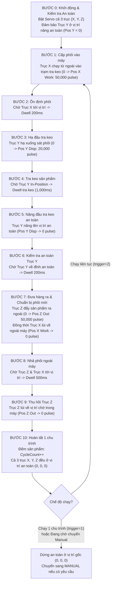

# GIAO THỨC TRUYỀN THÔNG & ĐẶC TẢ LỆNH ĐIỀU KHIỂN HỆ THỐNG 3 TRỤC (X, Y, Z)
## MÁY TRA KEO TỰ ĐỘNG (AUTOMATED 3-AXIS GLUE DISPENSING MACHINE)
### DÀNH CHO LẬP TRÌNH VIÊN PHÁT TRIỂN GIAO DIỆN PC (C# / PYTHON / QT)

> **Dự án:** Điều khiển 3 bộ Driver - Động cơ bước Ezi-SERVO II Plus-E qua STM32F767ZI (TOP Engineering E7502 IO Board)  
> **Cấu hình 3 Trục:**
> - **Trục X (Axis 0 - Infeed):** Đưa phôi hàng từ bên ngoài vào vị trí trạm tra keo trong máy (`192.168.0.2:3002`)
> - **Trục Y (Axis 1 - Dispensing Head):** Di chuyển nâng/hạ đầu tra keo (`192.168.0.3:3002`)
> - **Trục Z (Axis 2 - Outfeed):** Đưa sản phẩm thành phẩm đã tra keo ra bên ngoài máy (`192.168.0.4:3002`)
>
> **Kiến trúc Command:** Kế thừa & chuẩn hóa theo kiến trúc `CommandSet` từ dự án chuẩn `PG_StudyProject_Test` của TOP Engineering.

---

## 1. TỔNG QUAN PHƯƠNG THỨC GIAO TIẾP (INTERFACE)

Hệ thống hỗ trợ song song 2 kênh giao tiếp độc lập:

| Thông số | Kênh Ethernet (Ưu tiên cho PC UI) | Kênh RS-232 UART (Dành cho Debug / Serial UI) |
| :--- | :--- | :--- |
| **Giao thức** | UDP Datagram (Non-blocking) | Serial UART (8-N-1) |
| **Địa chỉ IP STM32** | `192.168.0.100` | Cổng COM (Silicon Labs / CH340 / DB9) |
| **Cổng / Baudrate** | Port: **`5000`** | Baudrate: **`115200 bps`** |
| **Địa chỉ IP PC** | Bất kỳ trong dải `192.168.0.x` (vd: `192.168.0.10`) | - |
| **Ký tự kết thúc dòng** | `\r\n` hoặc `\n` | `\r\n` |
| **Độ trễ phản hồi** | < 2 ms | < 5 ms |

---

## 2. QUY ƯỚC ĐỊNH DANH TRỤC (AXIS IDENTIFIER)

Trong tất cả các lệnh điều khiển, tham số `<axis>` có thể được truyền dưới các dạng sau (không phân biệt hoa thường):
- **Trục X:** `X` hoặc `0`
- **Trục Y:** `Y` hoặc `1`
- **Trục Z:** `Z` hoặc `2`
- **Cả 3 trục cùng lúc:** `ALL` hoặc `3` hoặc `*`

---

## 3. BẢNG DANH MỤC LỆNH CHI TIẾT (3-AXIS COMMAND LIST)

### 3.1 Nhóm Lệnh Động Cơ (`MOTOR`)

| Lệnh | Tham số | Ý nghĩa | Ví dụ gửi | Phản hồi mẫu từ STM32 |
| :--- | :--- | :--- | :--- | :--- |
| `MOTOR.SERVO` | `[axis] <0\|1>` | Bật (1) hoặc Tắt (0) cuộn dây Servo (nếu bỏ qua axis sẽ áp dụng cho cả 3 trục) | `MOTOR.SERVO X 1` `MOTOR.SERVO ALL 1` `MOTOR.SERVO 1` | `>>MOTOR;SERVO;AXIS=X;STATE=ON;OK\r\n` `>>MOTOR;SERVO;AXIS=ALL;STATE=ON;OK\r\n` |
| `MOTOR.ALARM_RESET` | `[axis]` | Xóa cảnh báo Alarm trên Driver | `MOTOR.ALARM_RESET` `MOTOR.ALARM_RESET Y` | `>>MOTOR;ALARM_RESET;AXIS=ALL;ALARM_RESET=SUCCESS;OK\r\n` `>>MOTOR;ALARM_RESET;AXIS=Y;ALARM_RESET=SUCCESS;OK\r\n` |
| `MOTOR.CLEAR_POS` | `[axis]` | Đặt vị trí hiện tại làm gốc 0 pulse | `MOTOR.CLEAR_POS` `MOTOR.CLEAR_POS X` | `>>MOTOR;CLEAR_POS;AXIS=ALL;POS_CLEARED=0;OK\r\n` |
| `MOTOR.MOVE_ABS` | `<axis> <pos> [speed]` | Chạy trục đến tọa độ tuyệt đối (pulse, pps) | `MOTOR.MOVE_ABS X 50000 20000` `MOTOR.MOVE_ABS Y 20000 10000` | `>>MOTOR;MOVE_ABS;AXIS=X;TARGET=50000;SPEED=20000;OK\r\n` |
| `MOTOR.MOVE_INC` | `<axis> <dist> [speed]` | Chạy trục khoảng cách tương đối (pulse, pps) | `MOTOR.MOVE_INC Z 10000 15000` | `>>MOTOR;MOVE_INC;AXIS=Z;DIST=10000;SPEED=15000;OK\r\n` |
| `MOTOR.MOVE_VEL` | `<axis> <speed> [dir]` | Chạy vận tốc liên tục (`1`=CW, `0`=CCW) | `MOTOR.MOVE_VEL Y 10000 1` | `>>MOTOR;MOVE_VEL;AXIS=Y;SPEED=10000;DIR=CW;OK\r\n` |
| `MOTOR.JOG` | `<axis> <+\|-\|STOP> [speed]` | Jog trục X, Y hoặc Z | `MOTOR.JOG X + 10000` `MOTOR.JOG Y STOP` `MOTOR.JOG STOP` | `>>MOTOR;JOG;AXIS=X;DIR=CW;SPEED=10000;OK\r\n` `>>MOTOR;JOG;DIR=STOP;ALL_AXES=STOPPED;OK\r\n` |
| `MOTOR.STOP` | `[axis]` | Dừng giảm tốc êm (mặc định dừng cả 3 trục) | `MOTOR.STOP` `MOTOR.STOP X` | `>>MOTOR;STOP;AXIS=ALL;DECEL_STOP=SUCCESS;CYCLE=STOPPED;OK\r\n` |
| `MOTOR.ESTOP` | *(Không)* | **DỪNG KHẨN CẤP LẬP TỨC CẢ 3 TRỤC** | `MOTOR.ESTOP` | `>>MOTOR;ESTOP;EMERGENCY_STOP=ALL_AXES_STOPPED;CYCLE=ABORTED;OK\r\n` |
| `MOTOR.GET_POS` | `[axis]` | Đọc tọa độ thực tế và mục tiêu | `MOTOR.GET_POS` `MOTOR.GET_POS X` | `>>MOTOR;GET_POS;X_ACT=50000;X_CMD=50000;Y_ACT=0;Y_CMD=0;Z_ACT=0;Z_CMD=0;OK\r\n` |
| `MOTOR.GET_STATUS`| `[axis]` | Đọc trạng thái toàn diện | `MOTOR.GET_STATUS` `MOTOR.GET_STATUS Y` | `>>MOTOR;GET_STATUS;X_ACT=0;X_ST=0x00000003;Y_ACT=0;Y_ST=0x00000003;Z_ACT=0;Z_ST=0x00000003;MODE=MANUAL;STEP=0;CYCLE=0;OK\r\n` |
| `MOTOR.SET_SPEED` | `<axis> <speed_pps>` | Đặt tốc độ mặc định cho trục | `MOTOR.SET_SPEED X 20000` | `>>MOTOR;SET_SPEED;AXIS=X;SPEED=20000;OK\r\n` |
| `MOTOR.SET_MODE` | `<0\|1\|TOGGLE>` | Đặt chế độ (0 = MANUAL, 1 = AUTO) | `MOTOR.SET_MODE 1` | `>>MOTOR;SET_MODE;MODE=AUTO;STATUS=SWITCHED;OK\r\n` |
| `MOTOR.GET_MODE` | *(Không)* | Đọc chế độ hiện tại | `MOTOR.GET_MODE` | `>>MOTOR;GET_MODE;MODE=MANUAL;PENDING=NONE;OK\r\n` |
| `MOTOR.START` | `[1\|2]` | Khởi động chu trình tra keo tự động (1: 1 sản phẩm, 2: liên tục) | `MOTOR.START 1` | `>>MOTOR;START;MODE=AUTO;CYCLE=SINGLE;TRIGGER=1;STATUS=3AXIS_DISPENSING_STARTED;OK\r\n` |
| `MOTOR.AUTO_CYCLE`| `<0\|1\|2>` | Điều khiển chu trình Auto (0: Dừng, 1: 1 lần, 2: Liên tục) | `MOTOR.AUTO_CYCLE 1` | `>>MOTOR;AUTO_CYCLE;TRIGGER=1;CYCLE_COUNT=0;MODE=AUTO;OK\r\n` |
| `MOTOR.AUTO_CONFIG`| `<x_work> <y_disp> <z_out> [disp_ms]` | Cài đặt tọa độ và thời gian tra keo 3 trục | `MOTOR.AUTO_CONFIG 50000 20000 50000 1000` | `>>MOTOR;AUTO_CONFIG;X_WORK=50000;Y_DISP=20000;Z_OUT=50000;DISP_TIME_MS=1000;OK\r\n` |
| `MOTOR.HELP` | `[lenh]` | Trợ giúp danh sách lệnh | `MOTOR.HELP` | `>>MOTOR;HELP;CMD_LIST=help, servo, enable, start, move_abs...;OK\r\n` |

---

### 3.2 Các Lệnh Phím Tắt Trực Tiếp (Top-level Shortcuts)

| Lệnh gửi | Chức năng tương đương | Ví dụ | Phản hồi mẫu |
| :--- | :--- | :--- | :--- |
| `HELP` | Liệt kê tất cả các lệnh top-level | `HELP` | `>>HELP;CMD_LIST=help, motor, system, sys, io, servo, mode, start, stop, move, jog...;OK\r\n` |
| `SERVO` | Bật/tắt Servo | `SERVO 1` `SERVO Y 1` `SERVO ALL 0` | `>>MOTOR;SERVO;AXIS=ALL;STATE=ON;OK\r\n` |
| `MODE` | Đọc / Chuyển chế độ vận hành | `MODE` `MODE 1` `MODE 0` | `>>MOTOR;MODE;MODE=AUTO;STATUS=SWITCHED;OK\r\n` |
| `START` | Khởi động chu trình tra keo tự động | `START` `START 2` | `>>MOTOR;START;MODE=AUTO;CYCLE=SINGLE;TRIGGER=1;STATUS=3AXIS_DISPENSING_STARTED;OK\r\n` |
| `STOP` | Dừng chu trình Auto và giảm tốc dừng cả 3 trục | `STOP` | `>>MOTOR;STOP;AXIS=ALL;DECEL_STOP=SUCCESS;CYCLE=STOPPED;OK\r\n` |
| `ESTOP` | Dừng khẩn cấp tức thì toàn bộ 3 trục | `ESTOP` | `>>MOTOR;ESTOP;EMERGENCY_STOP=ALL_AXES_STOPPED;CYCLE=ABORTED;OK\r\n` |
| `MOVE` | Chạy vị trí tuyệt đối | `MOVE X 50000 20000` | `>>MOTOR;MOVE_ABS;AXIS=X;TARGET=50000;SPEED=20000;OK\r\n` |
| `JOG` | Chạy Jog trục thủ công | `JOG X + 10000` `JOG Y STOP` `JOG STOP` | `>>MOTOR;JOG;AXIS=X;DIR=CW;SPEED=10000;OK\r\n` |
| `STATUS` | Đọc trạng thái 3 trục | `STATUS` `STATUS Z` | `>>MOTOR;STATUS;X_ACT=0;X_ST=...;Y_ACT=0;Y_ST=...;Z_ACT=0;Z_ST=...;OK\r\n` |
| `POS` | Đọc tọa độ 3 trục | `POS` `POS X` | `>>MOTOR;POS;X_ACT=0;X_CMD=0;Y_ACT=0;...;OK\r\n` |
| `ALARM_RESET` | Xóa cảnh báo lỗi Driver | `ALARM_RESET` | `>>MOTOR;ALARM_RESET;AXIS=ALL;ALARM_RESET=SUCCESS;OK\r\n` |
| `CLEAR_POS` | Đặt gốc 0 pulse | `CLEAR_POS` | `>>MOTOR;CLEAR_POS;AXIS=ALL;POS_CLEARED=0;OK\r\n` |
| `PING` | Kiểm tra thông tuyến mạng | `PING` | `>>SYS;PING;PONG;TICK=128000;OK\r\n` |
| `RESET` | Khởi động lại STM32 | `RESET` | `>>SYS;RESET;REBOOTING;OK\r\n` |

---

## 4. LƯU ĐỒ CHU TRÌNH TỰ ĐỘNG MÁY TRA KEO 3 TRỤC (AUTO DISPENSING SEQUENCE)

Khi gửi lệnh `START` (hoặc nhấn nút START phần cứng trên Driver CN1):

---

## 5. QUY TẮC AN TOÀN LIÊN ĐỘNG (INTERLOCK & SAFETY GUARANTEE)

1. **Khóa liên động Trục Y (Vertical Collision Avoidance):**
   - Trục Y (đầu tra keo) **bắt buộc phải ở vị trí an toàn trên cao (`Pos Y = 0`)** trước khi Trục X hoặc Trục Z được phép chạy ngang.
   - Tránh tuyệt đối va chạm gãy vỡ kim tra keo và sản phẩm.
2. **Quy tắc hoàn thành chu trình (Cycle-Completion Safety):**
   - Khi máy đang chạy chu trình Auto mà người vận hành chuyển sang chế độ **MANUAL** (`MODE 0`), máy **KHÔNG DỪNG ĐỘT NGỘT** giữa chừng làm hỏng sản phẩm, mà sẽ hoàn thành nốt các bước (hút/nhả xong, đưa thành phẩm ra ngoài, cả 3 trục về vị trí an toàn `0, 0, 0`), sau đó mới chính thức chuyển sang chế độ MANUAL.
   - Trong quá trình máy chạy nốt chu trình, lệnh `MODE` trả về `PENDING=WAITING_AUTO_CYCLE_FINISH`.
3. **Khóa chuyển động thủ công khi ở chế độ AUTO:**
   - Khi `MODE = AUTO`, toàn bộ lệnh `JOG`, `MOVE_ABS`, `MOVE_INC`, `MOVE_VEL` trên cả 3 trục đều bị **KHÓA CỨNG** để bảo đảm an toàn.
4. **Dừng khẩn cấp:**
   - Khi gửi lệnh `ESTOP` hoặc nhấn nút dừng khẩn cấp phần cứng, cả 3 trục lập tức ngắt xung dừng khẩn cấp ngay tại chỗ.
